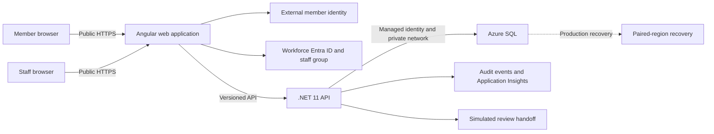

# Member Profile Application Architecture

**Status: Proposed.** This document records the current architecture baseline
for review. It does not describe an implemented or approved system. Update it as
requirements are clarified and decisions are reviewed.

## Purpose and audience

This explanation is for product, architecture, security, and engineering
reviewers. It describes the member profile application's confirmed needs, a
first-cut system boundary, and the decisions that remain open. It is not a
deployment plan, API contract, or Spec Kit implementation plan.

## Scope and design status

The initial demo uses synthetic data. The target production design must support
real member information and account-to-profile authorization. The workflow
integration described here is simulated for the demo; no ticketing product or
production integration has been selected.

The project constitution establishes Angular with TypeScript, C#/.NET 11, Azure
SQL, and Bicep. It also requires Entra-based identity, managed identities for
service access, private data-service endpoints, approved US-region residency,
auditing for state changes, and p95 API latency below 300 ms at an agreed peak
load.

## Confirmed requirements

| Area                           | Requirement                                                                                                                                                                                                                                                               |
| ------------------------------ | ------------------------------------------------------------------------------------------------------------------------------------------------------------------------------------------------------------------------------------------------------------------------- |
| User experience                | One public web application with member and staff-specific screens.                                                                                                                                                                                                        |
| Member access                  | A member can access only their own profile. Before staff verifies the account-to-profile link, the member can see only their own submitted enrollment details and cannot edit the profile.                                                                                |
| Staff access                   | Staff sign in with organization-managed Microsoft Entra accounts. Membership in a designated Entra group grants staff access to create, read, and update all profiles.                                                                                                    |
| Enrollment                     | Members can start enrollment. Staff verification can link an enrollment to a staff-created profile or approve creation of a new profile. The demo enrollment process is simulated.                                                                                        |
| Profile data                   | Name, email, phone, date of birth, and mailing address. Whether members under 18 are in scope is unknown.                                                                                                                                                                 |
| Memberships                    | A member can have multiple memberships. Each membership has an application-generated number, type, status, and start and end dates. Type and status values remain open. Ended memberships remain as history.                                                              |
| Updates                        | Verified members can update contact information directly. Membership changes are submitted through the application, reviewed through a separate process, and their status or outcome may be shown in the application. Staff apply approved changes through staff screens. |
| Profile identifiers and search | The application generates a member number and a separate number for each membership. Staff need to search by member number, membership number, name, and email. A number is a lookup aid, not proof of identity.                                                          |
| Data ownership                 | The application is the source of truth for profile and membership data.                                                                                                                                                                                                   |
| Audit                          | Internal audit records capture who changed what, when, and the outcome. They do not need before-and-after profile values.                                                                                                                                                 |
| API                            | The web application is the initial API consumer. Other systems may consume a versioned API in the future.                                                                                                                                                                 |
| Demo and production            | The initial demo uses synthetic data. Production targets South Central US with its paired US region available for recovery. Initial production recovery objectives are roughly two hours for both restoration time and data loss.                                         |

## Proposed system boundary

The following diagram is a discussion model, not a deployment diagram. Azure
hosting products for the web application and API remain under review.

### Identity and authorization

Passwordless email one-time-code sign-in is the member preference. Microsoft
Entra External ID is a candidate for customer identity, not an accepted
selection. Its exact passwordless flow, configuration, and data-location
implications must be verified before that choice is made. Staff use workforce
Entra ID, with a designated group controlling staff access.

The API, not the browser, must enforce authorization on every request. It must
derive a verified member's profile association from trusted identity data and
allow access only to that member's profile. The membership number, member
number, and email are not sufficient proof to claim a profile. Staff verification
is required before linking an external account to a profile or granting access
to full profile data.

Pending members may view only their own enrollment details. The account-to-
profile matching and verification experience is intentionally not finalized;
the demo may simulate it, but production must have a reviewed, secure process.

### Data and workflows

The following entities are conceptual and do not define a database schema:

- **Member:** generated member number and contact details.
- **Membership:** generated membership number, type, status, and dates; a member
  may have multiple memberships, including ended records.
- **Enrollment:** member-submitted enrollment information and its verification
  state.
- **Membership change request:** a member-submitted request and the status or
  outcome visible to that member.
- **Audit event:** actor, operation or changed fields, timestamp, and outcome;
  exclude profile values and other unnecessary personal data.

For membership changes, the application records the request, while review
occurs through a separate process. The demo simulates the handoff. The eventual
ticketing system, its integration contract, and how final review outcomes are
returned remain open. Staff apply approved membership changes in the
application. The exact status-update workflow for the demo also remains open.

Inactive profiles and ended membership records are retained. The retention
period is not yet defined. Legal and privacy review is needed before setting a
production retention or deletion policy, especially if minors or international
members are in scope.

### API, data access, and operations

The API is the authorization and business-logic boundary for both the Angular
application and future consumers. Public API contracts must be versioned. The
authentication and authorization model for future non-browser consumers is
open; do not assume browser tokens or introduce API keys.

Azure SQL is the proposed system of record. The API should connect using a
managed identity over private networking. The SQL service must use a private
endpoint with public network access disabled. Encrypt data in transit and at
rest; determine customer-managed key needs during data-classification and
security review.

State-changing requests must emit structured audit events and use correlation
IDs. Application Insights telemetry must not contain profile values or other
PII; local authentication for telemetry ingestion remains disabled per the
constitution. Errors returned to clients must not expose stack traces.

## Production recovery and residency

South Central US is the preferred primary region. Microsoft documents North
Central US as its paired region, and paired-region recovery is acceptable in
principle. An Azure SQL failover group is a candidate for database recovery, not
a complete application recovery design. The production plan must also cover the
web application, API hosting, network and ingress, identity dependencies,
operational access, and recovery procedures.

The roughly two-hour recovery time objective and recovery point objective apply
to the eventual production application, not just SQL. They must be demonstrated
through end-to-end recovery exercises at the selected service tiers and
configuration. Availability targets and expected peak load are still unknown;
the p95 latency objective cannot be evaluated against an invented load.

The current constitution limits data residency to approved US regions. Future
non-US data residency is an expressed possibility, not part of the current
design approval. It requires privacy, security, and governance review; changing
the constitution's US-only constraint requires its amendment process.

## Well-Architected review snapshot

| Pillar                 | Current design direction                                                                                                                                                      | Evidence or open concern                                                                                                                          |
| ---------------------- | ----------------------------------------------------------------------------------------------------------------------------------------------------------------------------- | ------------------------------------------------------------------------------------------------------------------------------------------------- |
| Security               | Entra identities, group-based staff access, API-side authorization, verified profile linking, managed identities, private SQL access, and PII-minimizing audit and telemetry. | The member identity provider and production account-claim process need review. Date of birth is sensitive data; minor-member handling is unknown. |
| Reliability            | Plan paired-region recovery for the full application and SQL.                                                                                                                 | The two-hour RTO/RPO is a target to test, not a guarantee from one service. Availability target and operating ownership are open.                 |
| Performance efficiency | Keep the API stateless where practical and evaluate it against the required p95 target.                                                                                       | Expected peak load and profile volume are unknown, so sizing and latency validation are pending.                                                  |
| Cost optimization      | Prefer a simple deployment and compare serverless and container hosting; consider active/passive recovery before active/active.                                               | Budget, availability requirement, and usage profile are unknown. No cost estimate is justified yet.                                               |
| Operational excellence | Deploy infrastructure through Bicep and pipelines; use structured telemetry, audit events, and recovery runbooks.                                                             | Application operations ownership and support model are undecided.                                                                                 |

## Open decisions

See the [design review](design-review.md) for options and review prompts. Major
open items include API and frontend hosting, exact member identity flow,
enrollment verification details, membership types and statuses, ticketing
integration, API consumer authorization, expected load, availability, budget,
retention, minor-member handling, and international residency.

## References

- [Project constitution](../../.specify/memory/constitution.md)
- [Repository architecture guidance](../../.github/instructions/architecture.instructions.md)
- [Microsoft Entra External ID overview](https://learn.microsoft.com/en-us/entra/external-id/external-identities-overview)
- [Azure region pairs](https://learn.microsoft.com/en-us/azure/reliability/regions-paired)
- [Azure SQL failover groups](https://learn.microsoft.com/en-us/azure/azure-sql/database/failover-group-sql-db)
- [Azure SQL business continuity guidance](https://learn.microsoft.com/en-us/azure/azure-sql/database/business-continuity-high-availability-disaster-recover-hadr-overview)
